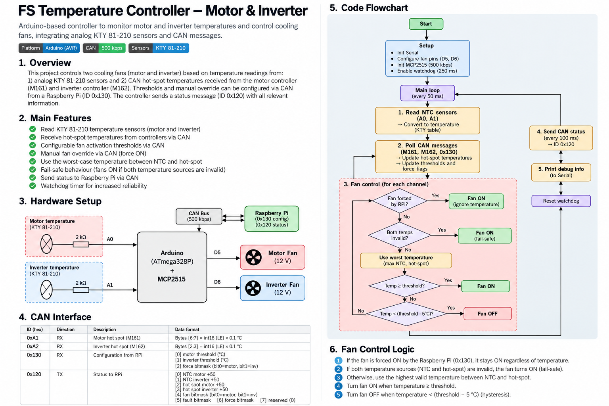
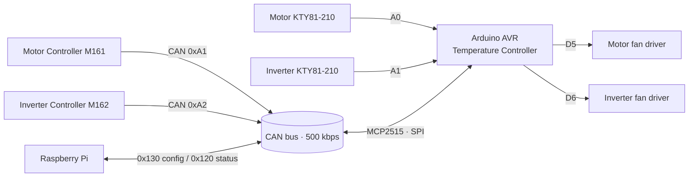
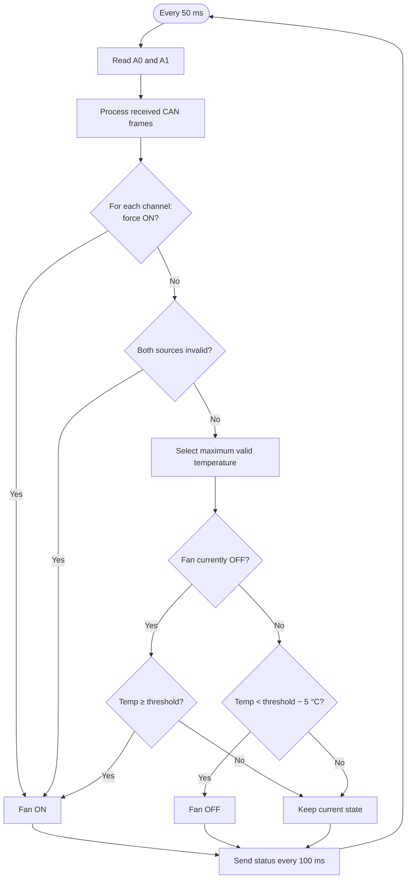

# 🌡️ FS Temperature Controller
### Motor & Inverter Cooling · Formula Student EV

**Dual-channel temperature monitoring and automatic fan control over CAN bus.**

   

> [!IMPORTANT]
> This is prototype control software, **not a certified safety system**. Validate sensor characteristics, CAN message mapping, electrical interfaces and fail-safe behavior before use on a vehicle.

## Overview

The **FS Temperature Controller** reads two analog KTY81-210 temperature sensors and receives motor/inverter hot-spot measurements over CAN. Each cooling fan is controlled independently using the **highest valid temperature**, configurable thresholds and **5 °C hysteresis**. A Raspberry Pi can update thresholds and request forced fan activation via CAN.

## Features

- 🌡️ Independent motor and inverter temperature channels
- 📡 CAN hot-spot measurements from M161 (`0xA1`) and M162 (`0xA2`)
- 🧠 Highest-valid-temperature control with 5 °C hysteresis
- ⚙️ Runtime thresholds and force-ON flags from Raspberry Pi (`0x130`)
- 🛡️ Fan ON if **both** temperature sources for a channel are unavailable
- 📤 10 Hz status broadcast (`0x120`)
- ⏱️ AVR watchdog (250 ms) and serial diagnostics

## System architecture

> [!WARNING]
> **D5/D6 are logic outputs, not fan power outputs.** Drive fans using correctly rated MOSFET/relay stages, protection and a suitable power supply. Confirm output polarity and safe power-up states.

## Hardware & wiring

| Connection | Arduino pin | Purpose |
|---|---|---|
| Motor KTY81-210 divider | `A0` | Analog motor temperature |
| Inverter KTY81-210 divider | `A1` | Analog inverter temperature |
| Motor fan driver | `D5` | Active-HIGH control |
| Inverter fan driver | `D6` | Active-HIGH control |
| MCP2515 CS | `D10` | SPI chip select |
| MCP2515 SPI | Board hardware SPI pins | CAN controller communication |

**Analog front-end assumptions:** `R_SERIES = 2 kΩ`, `V_REF = 5 V`, 10-bit ADC (`0…1023`). The firmware assumes the **KTY sensor connects to ground**, the **2 kΩ resistor connects to +5 V**, and the analog input measures their junction: `R_KTY = R_SERIES × Vout / (V_REF − Vout)`.

**CAN controller:** MCP2515 with an **8 MHz oscillator** (`MCP_8MHZ`), configured for **500 kbps**. Ensure the physical module oscillator, transceiver voltage levels, bus termination and common-mode requirements match the vehicle network.

> [!NOTE]
> KTY81-210 is a **PTC silicon temperature sensor**, not an NTC thermistor. Variable names such as `ntc_temp` in the current sketch are historical naming only.

## CAN protocol

All IDs below are **11-bit standard CAN identifiers**. Multi-byte hot-spot values are signed **little-endian int16**, scaled by **0.1 °C**.

### Receive (RX)

| CAN ID | Source | DLC | Payload |
|---|---|---:|---|
| `0x0A1` | Motor controller · M161 | ≥ 8 | `[6:7]` motor hot spot, int16 LE × 0.1 °C |
| `0x0A2` | Inverter controller · M162 | ≥ 4 | `[2:3]` inverter hot spot, int16 LE × 0.1 °C |
| `0x130` | Raspberry Pi | ≥ 3 | `[0]` motor threshold, `[1]` inverter threshold, `[2]` force mask |

For configuration (`0x130`): thresholds are whole degrees Celsius and accepted only within **20–150 °C**. Invalid threshold values leave the existing setting unchanged. Force mask: **bit 0 = motor**, **bit 1 = inverter**; `1` forces the corresponding fan ON.

### Transmit (TX): status `0x120`

Sent every **100 ms** (nominal 10 Hz), DLC = 8.

| Byte | Description | Encoding |
|---:|---|---|
| 0 | Motor analog temperature | `uint8(temp + 50)` |
| 1 | Inverter analog temperature | `uint8(temp + 50)` |
| 2 | Motor CAN hot spot | `uint8(temp + 50)` |
| 3 | Inverter CAN hot spot | `uint8(temp + 50)` |
| 4 | Fan state mask | bit 0 motor, bit 1 inverter |
| 5 | Analog sensor fault mask | bit 0 motor, bit 1 inverter |
| 6 | Force-ON mask | bit 0 motor, bit 1 inverter |
| 7 | Reserved | `0x00` |

Temperature bytes are **clamped to 0–255**, with **1 °C resolution**. The current firmware encodes the `-99 °C` invalid sentinel as **0**, which also corresponds to a valid encoded temperature of `-50 °C`; consumers must not treat byte 0 alone as a reliable validity flag. The fault mask only represents invalid **analog** readings.

## Control logic

**Default threshold:** 50 °C for each channel. At this setting, a fan turns **ON at ≥ 50 °C** and turns **OFF below 45 °C**. Between those limits, it retains its previous state.

### Source priority

1. If force-ON is enabled, the fan runs regardless of temperature.
2. If both analog and CAN temperatures are invalid, the fan runs as a fail-safe.
3. Otherwise, use the **higher valid temperature** for control.

## Timing and diagnostics

| Task | Nominal interval |
|---|---:|
| Main loop / fan update | 50 ms |
| CAN status frame | 100 ms |
| Watchdog timeout | 250 ms |
| Serial baud rate | 115200 |

The serial monitor reports sensor values, CAN hot spots, fan states, force flags and thresholds.

## Build & upload

1. Install the **Arduino IDE** or Arduino CLI and select your actual AVR board.
2. Install an MCP2515 library exposing `#include <mcp2515.h>` and the `MCP2515` API used in the sketch (for example, the **autowp/arduino-mcp2515** library).
3. Connect the two KTY divider inputs, the MCP2515 SPI interface and **external fan drivers**.
4. Verify the MCP2515 oscillator is **8 MHz**; change `MCP_8MHZ` if necessary.
5. Open the `.ino` sketch, compile and upload. Monitor serial output at **115200 baud**.
6. Test CAN RX/TX, forced ON, threshold transitions and sensor fault behavior on the bench **before connecting vehicle loads**.

## Safety limitations & validation checklist

> [!CAUTION]
> The present code has important limitations that should be addressed before vehicle deployment:
>
> - **No CAN freshness timeout:** previously received hot-spot values remain valid indefinitely if messages stop arriving.
> - **No out-of-range sensor fault:** the KTY lookup clamps values beyond its table to −50 °C or +150 °C, potentially hiding faults.
> - **CAN input validation is incomplete:** received temperatures are not plausibility-checked; message authenticity and extended-frame handling are not explicitly enforced.
> - **Watchdog reset is not a guaranteed fan-ON state:** outputs are initialized LOW; a reset, startup or stalled MCU may leave fans OFF without hardware fail-safe design.
> - **CAN setup failure halts execution** before the watchdog is enabled, with fan outputs LOW.
> - **Status encoding loses precision** and has no unambiguous validity code for all temperature sources.

Recommended bench tests: cold/hot sensor response, disconnected/shorted sensor, missing CAN messages, corrupted frames, force-ON commands, threshold changes, watchdog reset, supply interruption and fan-driver faults.

## Configuration reference

| Constant | Default | Meaning |
|---|---:|---|
| `R_SERIES` | `2000.0` Ω | Analog divider resistor |
| `V_REF` | `5.0` V | ADC reference assumption |
| `HYSTERESIS` | `5.0` °C | Fan OFF margin |
| `fan_threshold[]` | `50.0` °C | Initial thresholds |
| `LOOP_PERIOD` | `50` ms | Control interval |
| `CAN_TX_PERIOD` | `100` ms | Status interval |
| `CAN_500KBPS` | 500 kbps | CAN bus bitrate |
| `MCP_8MHZ` | 8 MHz | CAN controller oscillator |

---

**Built for Formula Student EV · Electronics & Software**

*Measure → Decide → Cool → Report*

