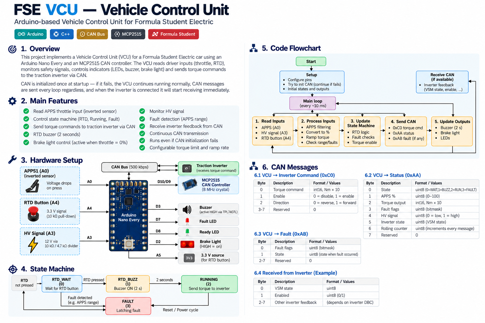

<div align="center">

# FSE VCU — Vehicle Control Unit

**Arduino-based control unit for the Formula Student Electric vehicle**


</div>

---

## Overview

The **FSE Vehicle Control Unit (VCU)** runs on an Arduino Nano Every and uses an MCP2515 CAN controller to communicate with the traction inverter. It reads the accelerator pedal position sensor (APPS), manages the Ready-To-Drive (RTD) sequence, calculates a torque command, and controls status indicators and driver feedback outputs.

The VCU is designed to continue its main loop if CAN initialization fails. In that situation, CAN messages cannot be transmitted or received, but the local logic continues to run.

> **Important:** The code comments identify this implementation as temporary bench/initial-testing firmware. It is not, by itself, evidence that the system meets all Formula Student rules or is ready for vehicle operation.

## System overview



The infographic summarizes the hardware connections, state machine, main loop, and CAN message layout documented below.

## Main features

- Reads a single, inverted APPS signal on `A0`.
- Converts the APPS ADC reading to a normalized percentage using a deadzone/scaling function.
- Checks the APPS ADC reading against configured raw limits and latches an APPS range fault.
- Implements an RTD wait, 2-second buzzer, running, and fault state machine.
- Sends torque commands to the inverter over CAN when CAN is available.
- Limits the commanded torque and ramps the command toward the target.
- Receives inverter state and fault messages when available.
- Controls the brake light, buzzer, ready/fault LEDs, and HV-related signal indication.
- Sends dashboard telemetry on CAN ID `0x101` every 100 ms.
- Continues local execution if MCP2515 initialization fails.

## Hardware

### Main components

| Component | Connection | Notes |
|---|---|---|
| Arduino Nano Every | Main controller | Runs VCU firmware |
| MCP2515 CAN module | SPI, CS `D10`, INT `D9` (hardware note) | 8 MHz crystal, configured for 500 kbps |
| APPS1 | `A0` | Single inverted analog sensor in this test version |
| HV signal | `A3` | 12 V signal through a 10 kΩ / 4.7 kΩ divider |
| RTD button | `A4` | 3.3 V signal with 10 kΩ pull-down |
| RTD button 3.3 V source | `A5` | Configured as output and driven HIGH |
| Buzzer | `D3` | Active HIGH through TPL7407L |
| TSAL green relay | `D5` | Active LOW |
| TSAL red relay | `D6` | Active LOW |
| Fault LED | `D7` | Active HIGH |
| Ready LED | `D8` | Active HIGH |
| Brake light | `D2` | Active HIGH; currently follows APPS idle |

**Pin-map note:** The supplied code defines and drives the pins listed above. The MCP2515 interrupt pin `D9` is mentioned in the hardware comments but is not configured or read directly in the supplied source; the CAN library handles message polling.

## State machine

The VCU uses four states:

| State | Value | Behaviour |
|---|---:|---|
| `VCU_RTD_WAIT` | `0` | Waits for the RTD button and sends zero torque with the inverter disabled |
| `VCU_RTD_BUZZ` | `1` | Keeps torque at zero and activates the buzzer for 2 seconds |
| `VCU_RUNNING` | `2` | Calculates and sends the torque command |
| `VCU_FAULT` | `3` | Sends zero torque with the inverter disabled; a latched APPS range fault requires a power cycle to clear |

### RTD sequence

1. On startup, the VCU enters `VCU_RTD_WAIT`.
2. Pressing the RTD button moves the state to `VCU_RTD_BUZZ`.
3. The buzzer sounds for `2000 ms`; torque commands remain zero and disabled during this interval.
4. When the timer expires, the buzzer turns off, `rtdActive` is set, the ready LED is turned on, and the VCU enters `VCU_RUNNING`.
5. An APPS range fault moves the VCU to `VCU_FAULT` and disables RTD operation.

The current implementation does **not** require the brake to be pressed before RTD, as stated in the source comments.

## APPS processing and torque command

The APPS sensor is inverted: its ADC reading falls as the pedal is pressed.

| Parameter | Value in source | Meaning |
|---|---:|---|
| `APPS1_MIN` | `515` | Resting / 0% calibration point |
| `APPS1_MAX` | `460` | Full-press / 100% calibration point |
| `APPS_RAW_LOW_LIMIT` | `10` | Lower valid ADC bound |
| `APPS_RAW_HIGH_LIMIT` | `1010` | Upper valid ADC bound |
| `MAX_TORQUE_NM` | `11.5 Nm` | Temporary maximum torque command |
| `TORQUE_RAMP_RATE` | `0.25 Nm per 10 ms` | Maximum change in commanded torque per control update |
| `TORQUE_SCALE` | `10` | CAN torque encoding: raw value = Nm × 10 |

The target torque is calculated as:

`target torque = APPS percentage × MAX_TORQUE_NM`

The output is moved toward the target by at most `TORQUE_RAMP_RATE` each 10 ms control update. The code sends the torque value as a signed 16-bit integer scaled by 10.

The source currently defines only a single APPS channel. APPS plausibility checking between redundant sensors is disabled/not implemented in this version.

## CAN communication

The MCP2515 is configured for **500 kbps** with an **8 MHz** oscillator. CAN is initialized once in `setup()`. If initialization fails, `canReady` remains false; send functions return without transmitting and CAN reception is skipped.

### CAN IDs used

| CAN ID | Direction | Purpose | Length |
|---|---|---|---:|
| `0xC0` | VCU → inverter | Torque/enable/direction command | 8 bytes |
| `0xAA` | Inverter → VCU | Inverter state feedback | Read by code; expected format depends on inverter DBC |
| `0xAB` | Inverter → VCU | Inverter fault information | 8 bytes |
| `0x101` | VCU → dashboard | APPS, fault flags, rolling counter | 4 bytes |

### `0xC0` — inverter command

| Byte(s) | Meaning | Encoding |
|---|---|---|
| `0–1` | Torque command | Signed `int16`, little-endian, Nm × 10 |
| `2–3` | Reserved | `0` |
| `4` | Direction | `0` = reverse, `1` = forward |
| `5` | Enable + rolling counter | Bit 0 = enable; bits 4–7 = 4-bit rolling counter |
| `6–7` | Reserved | `0` |

The command is only sent when `canReady` is true. In RTD wait and buzzer states, the command is zero torque with enable false. In running state, enable is set true.

### `0xAA` — inverter state feedback

The code reads:
- `data[0]` into `vsmState`.
- Bit 0 of `data[6]` into `invEnabled`.
- Bit 7 of `data[6]` as an inverter enable-lockout warning.

The exact message layout should be checked against the inverter's DBC or official communication specification before relying on it.

### `0xAB` — inverter faults

The code interprets the eight-byte payload as four 16-bit little-endian fields:

| Bytes | Field |
|---|---|
| `0–1` | `postLo` |
| `2–3` | `postHi` |
| `4–5` | `runLo` |
| `6–7` | `runHi` |

If any field is non-zero, the values are printed to Serial. These inverter fault fields are logged; they do not currently set the VCU's own latched `FAULT_APPS_RANGE` flag.

### `0x101` — dashboard telemetry

Sent every 100 ms when CAN is available.

| Byte | Meaning |
|---|---|
| `0` | APPS percentage mapped to `0–255` |
| `1` | Reserved (`0`) |
| `2` | VCU fault flags |
| `3` | 4-bit rolling counter in the low nibble |

## Outputs and indicators

- **Buzzer (`D3`):** Active HIGH during the 2-second RTD buzzer state.
- **Ready LED (`D8`):** Set HIGH when the RTD sequence completes; turned off on a latched APPS fault.
- **Fault LED (`D7`):** HIGH whenever `faultFlags` is non-zero.
- **Brake light (`D2`):** HIGH when `apps1Pct <= 0.01`, i.e. when the throttle is effectively at idle in this temporary implementation.
- **TSAL outputs (`D5`, `D6`):** Updated based on the HV signal at `A3`; the relay outputs are active LOW.

## Configuration reference

| Constant | Default | Description |
|---|---:|---|
| `CAN_CS_PIN` | `10` | MCP2515 chip select |
| `APPS1_PIN` | `A0` | APPS analog input |
| `HV_SIGNAL_PIN` | `A3` | HV presence input via divider |
| `RTD_BUTTON_PIN` | `A4` | RTD button input |
| `RTD_BUZZER_MS` | `2000 ms` | RTD buzzer duration |
| `TSAL_BLINK_HZ` | `3` | Red TSAL blink frequency when HV signal is high |

## Build and use

1. Install the Arduino IDE or compatible Arduino build tool.
2. Select the **Arduino Nano Every** board.
3. Install the `mcp_can` library used by the sketch and its SPI dependency.
4. Connect the MCP2515 module using the configured chip-select pin and confirm the module has an 8 MHz oscillator.
5. Verify the CAN bus bitrate and inverter CAN database/specification before connecting the inverter.
6. Check APPS calibration values with the actual sensor and confirm raw ADC values at rest and full travel.
7. Upload the firmware and open Serial Monitor at **115200 baud**.
8. Bench-test the RTD sequence, torque command scaling, fault handling, and outputs with the drivetrain safely disabled.

> Library versions and exact installation steps may vary depending on the `mcp_can` library fork used by the project.

## Current limitations and safety work

The source explicitly marks this as a temporary bench/initial-testing version. Before vehicle use, review and validate at least the following:

- **Single APPS sensor:** redundant sensor plausibility checking is disabled.
- **BSE disabled:** brake-system encoder/check functionality is not implemented in this version.
- **RTD brake requirement disabled:** the RTD transition currently requires only the RTD button.
- **CAN timeout is not a latching fault:** loss of inverter communication does not itself trigger the VCU's latched fault state.
- **Torque command enable behaviour:** running state sends `enable = true`; verify this against all required interlocks and the inverter specification.
- **Fault handling:** the VCU's latched fault is currently the APPS raw-range fault; inverter faults are printed but do not latch the VCU into `VCU_FAULT`.
- **Brake light logic:** it currently follows throttle idle rather than a brake sensor.
- **HV input interface:** verify divider sizing, voltage ratings, input protection, isolation requirements, and logic thresholds on the actual hardware.
- **CAN payloads:** verify message IDs, byte positions, endianness, scaling, counters, and enable semantics against the actual inverter DBC/specification.
- **Electrical outputs:** verify driver circuitry, active levels, current limits, and reset/boot behaviour for every connected load.

This README describes the supplied code; it is not a safety certification or a substitute for the applicable Formula Student rules, system-level safety analysis, and on-car validation.

## Repository layout

```text
.
├── README.md
├── assets/
│   └── vcu-overview.png
└── <VCU sketch source>
```

## License

Add the license chosen for this project here. No license is inferred by this README.
